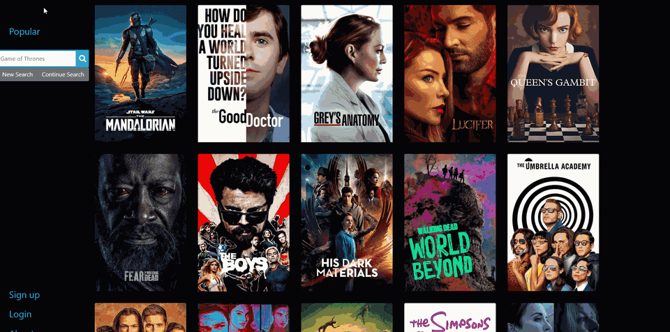

<div align="center" id="top"> 
  

  &#xa0;
</div>

<h1 align="center">SeriesRecommender</h1>

<p align="center">
  

  

  

  

  <!--  -->

  <!--  -->

  <!--  -->
</p>

<!-- Status -->

<!-- <h4 align="center"> 
	🚧  SeriesRecommender 🚀 Under construction...  🚧
</h4> 

<hr> -->

<p align="center">
  <a href="#dart-about">About</a> &#xa0; | &#xa0; 
  <a href="#sparkles-features">Features</a> &#xa0; | &#xa0;
  <a href="#rocket-technologies">Technologies</a> &#xa0; | &#xa0;
  <a href="#white_check_mark-requirements">Requirements</a> &#xa0; | &#xa0;
  <a href="#checkered_flag-starting">Starting</a> &#xa0; | &#xa0;
  <a href="#dart-todo">Todo</a> &#xa0; | &#xa0;
  <a href="#memo-license">License</a> &#xa0; | &#xa0;
  <a href="https://github.com/tauhir" target="_blank">Author</a>
</p>

<br>

## :dart: About ##

I needed a way to find television shows I might like so I built this webapp. It uses the TMDB API to find and display TV shows, which you can like or dislike to build up a recommended list.

Built in 2020 as a side project. It used to run on Heroku's free tier, so there's no hosted demo any more — the gif above shows it in action, and the steps below get it running locally.

## :sparkles: Features ##

:heavy_check_mark: Display current popular shows;\
:heavy_check_mark: Search for shows;\
:heavy_check_mark: Recommend shows based on liked and disliked shows;
:heavy_check_mark: Remember previous searches

## :rocket: Technologies ##

The following tools were used in this project:

- [Rails](https://rubyonrails.org/)
- [Node.js](https://nodejs.org/en/)
- [Webpack](https://webpack.js.org/)
- [TypeScript](https://www.typescriptlang.org/)

## :white_check_mark: Requirements ##

Before starting :checkered_flag:, you need to have [Git](https://git-scm.com) installed. You will also need to signup for [TMDB](https://developers.themoviedb.org/3/getting-started/introduction) user account which will give you access to an API key.

## :checkered_flag: Starting ##

```bash
# Clone this project
$ git clone https://github.com/tauhir/seriesrecommender

# Access folder
$ cd seriesrecommender

# Install dependencies using setup.sh script - this will install rbenv to manage ruby versions, postgres and node
$ chmod +x setup.sh
$ setup.sh

# Create your user role for the Postgres db (replace my username tauhir with yours):
$ sudo -u postgres createuser --superuser tauhir

# Start the Postgres server
$ sudo pg_ctlcluster 12 main start

# Open .envsample and replace the API key with your own. Save the file as .env

# First time running
$ rails db:create
$ rails db:migrate

# To start:
$ ./bin/webpack-dev-server & bundle exec rails s && fg

# The server will initialize in the <http://localhost:3000>
```

## :dart: Todo ##

Ideas that never made it in:
 - Speed up search (it's slow)
 - Dockerise the setup
 - Share lists with other people
 - Show where each show is available to stream
 - Handle searches with no results, and paginate past the first page

## :memo: License ##

This project is under license from MIT. For more details, see the [LICENSE](LICENSE) file.


Made with :heart: by <a href="https://github.com/tauhir" target="_blank">Tauhir</a>

&#xa0;

<a href="#top">Back to top</a>
